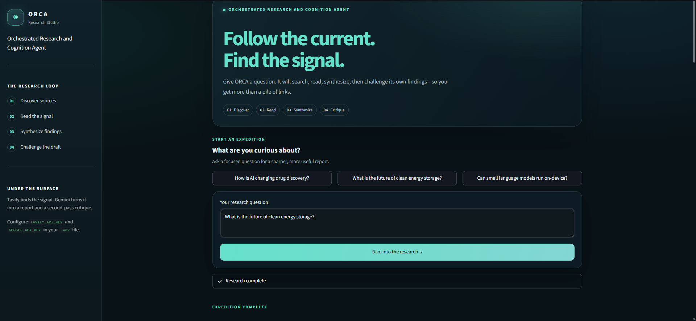
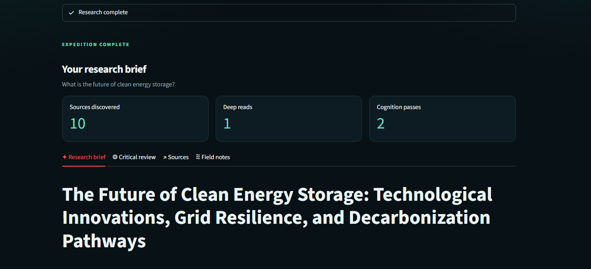

# ORCA — Research Studio

ORCA (Orchestrated Research and Cognition Agent) turns a research question into a sourced report. It searches the web with Tavily, reads the top search result, drafts a structured report with Google Gemini, and asks a second Gemini pass to critique that report.

## Demo

### Ask a research question



### Review a generated research brief



## How ORCA differs from a typical chatbot

A typical chatbot interaction is usually a direct prompt-and-response: the model answers from its available context, which may not include current web information. ORCA adds a research process around the model response:

| | Typical chatbot | ORCA |
| --- | --- | --- |
| Information gathering | Usually responds from the conversation and model context | Searches the web for recent information using Tavily |
| Source reading | May provide links, but does not necessarily read them | Scrapes the top search result for additional context |
| Response format | General conversational answer | Structured research report with key findings, conclusion, and source URLs |
| Review | Usually returns one response | Runs a separate critique pass that scores the report and identifies strengths and areas to improve |
| Results | Often presented as a single answer | Separates the report, critical review, sources, and field notes into tabs |

ORCA is designed to make research easier to inspect, not to guarantee that every claim is correct. Search coverage, source availability, and generated content can vary; review the linked sources when accuracy matters. The current pipeline reads the top-ranked search result, not every result.

## Research workflow

1. **Discover:** Search Tavily for recent and reliable information related to the question. ORCA requests up to five results.
2. **Read:** Scrape the top result and extract text for analysis.
3. **Synthesize:** Use Gemini to write a structured report from the search results and scraped text.
4. **Critique:** Ask Gemini to evaluate the report, provide a score, list strengths and improvements, and give a short verdict.

Completed research is shown in four tabs:

- **Research brief:** The generated report, with an option to download it as Markdown.
- **Critical review:** The second-pass critique.
- **Sources:** Search result titles and links.
- **Field notes:** Raw search results and scraped source text.

## Requirements

- Python 3.10 or newer
- A Tavily API key
- A Google AI API key supported by LangChain's `ChatGoogleGenerativeAI`

## Getting started

Run these commands from the project directory.

### Windows PowerShell

```powershell
python -m venv .venv
.\.venv\Scripts\Activate.ps1
python -m pip install -r requirements.txt
```

Create a `.env` file in the project root and add your API keys:

```dotenv
TAVILY_API_KEY=your_tavily_api_key
GOOGLE_API_KEY=your_google_api_key
```

Keep `.env` private; do not commit API keys.

Start the app:

```powershell
streamlit run app.py
```

Streamlit will print a local URL to open in your browser. Enter a question (up to 500 characters) or choose one of the suggested questions, then select **Dive into the research**. Both API keys must be configured for research to run.

### macOS or Linux

```bash
python -m venv .venv
source .venv/bin/activate
python -m pip install -r requirements.txt
```

Create the same `.env` file in the project root, then run:

```bash
streamlit run app.py
```

## Project structure

```text
.
├── app.py          # Streamlit interface and result views
├── agents.py       # Gemini report-writing and critique chains
├── pipeline.py     # Search, scrape, report, and critique workflow
├── tools.py        # Tavily search and web scraping tools
├── requirements.txt
└── demo/           # Application screenshots
```

## Technology

- [Streamlit](https://streamlit.io/) for the interactive web interface
- [LangChain](https://www.langchain.com/) and Google Gemini for report generation and critique
- [Tavily](https://tavily.com/) for web search
- Requests and Beautiful Soup for retrieving and extracting webpage text
